# HA Device Health

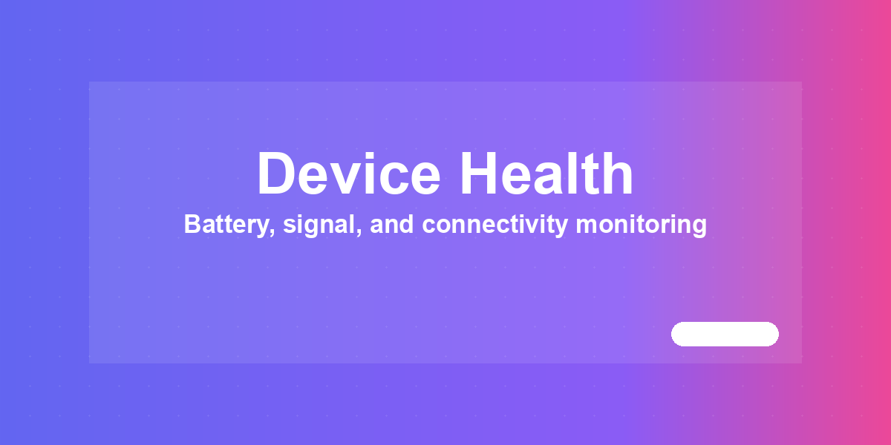

Monitor the health of your Home Assistant devices from one Lovelace card:
battery levels, availability and alerts. Zero configuration — add the card and it
joins Home Assistant's device and entity registries automatically.

[](https://github.com/MacSiem/ha-device-health/releases) [](LICENSE)

## How it works

**Short version: it works automatically.** The card reads device and entity
registries through your Home Assistant connection — no extra integration or YAML:

1. **Batteries.** An entity counts as a battery *level* only when it has
   a `%` unit together with `device_class: battery` (or a battery name when
   no conflicting device class is present), and a
   finite numeric state from 0 to 100. Decimal readings are preserved. Text and
   quantity helpers without battery-level metadata are excluded; humidity
   percentages are not battery readings.
2. **Availability.** Each registered device appears once. A device with no current
   entity state is marked unknown, not failed. A connectivity binary sensor's
   `off` or a router/connection tracker's `not_home` indicates disconnection;
   GPS absence and an ordinary switch's `off` do not. If another explicit
   connection is active, the device stays online. When all known connections
   drop, the offline delay starts at the latest valid disconnection time.
3. **Network evidence.** Bluetooth and Zigbee come from registry connections;
   Wi-Fi needs an explicit Wi-Fi connection type or SSID. A generic MAC or IP
   goes to Other, not Wi-Fi. Entity states without a registered device are
   counted separately and never counted as physical devices.
4. **Alerts.** Low-battery alerts and the needs-attention summary count each
   registered physical device once, using its lowest battery reading. Individual
   readings remain visible in Batteries; readings without a registered device
   remain independent. A continuous incident appears once in history. Dismissal
   lasts until recovery; a later incident can alert again. Live alert history and dismissal
   are held in card memory and reset when the card is recreated or the account
   changes. The separate recorded history below uses Home Assistant Recorder. Counts that need registry identity show a dash while it is unavailable.

### What is automatic vs. manual

| Automatic | Manual (optional) |
|---|---|
| Discovering batteries and devices | Adjusting alert thresholds |
| Filtering out Battery+ helper entities | Dismissing/reviewing alerts |
| Availability monitoring | — |

## Screenshots

Version 4.3 adds recorded history with selectable measurements and observed
episodes. These two frames show actual Recorder records from synthetic QA sensors
in Home Assistant 2026.10.1; the short test sequence is clustered near the end of
the seven-day range. No older measurements have been invented to fill the chart.

| History chart, English and light | Recorded episodes, Polish and dark |
|---|---|
| 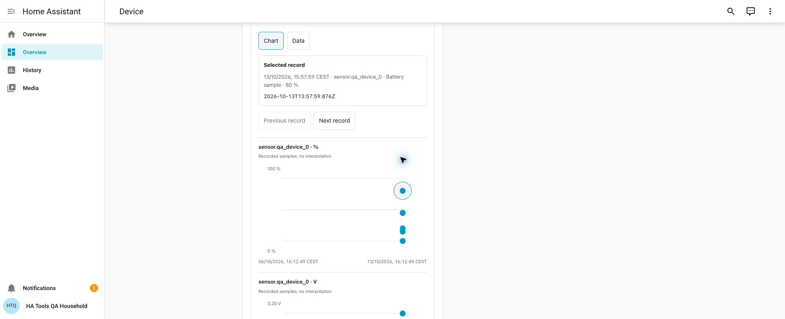 | 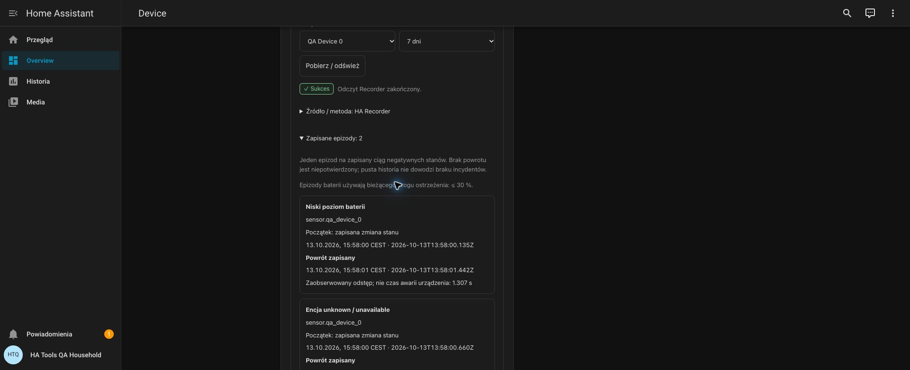 |

The earlier overview frames below were captured for 4.2.9; they illustrate the
existing tabs and are not evidence of the new history features.

These are native Home Assistant screenshots with synthetic QA devices and
reserved test addresses. They show the English light theme and Polish dark
theme; the device table is filtered to the three QA devices.

| View | English, light | Polish, dark, narrow |
|---|---|---|
| Devices | 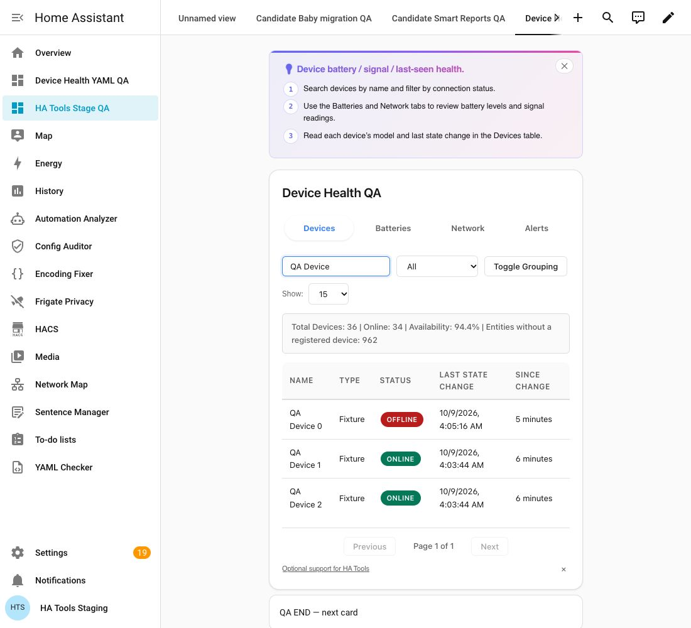 | 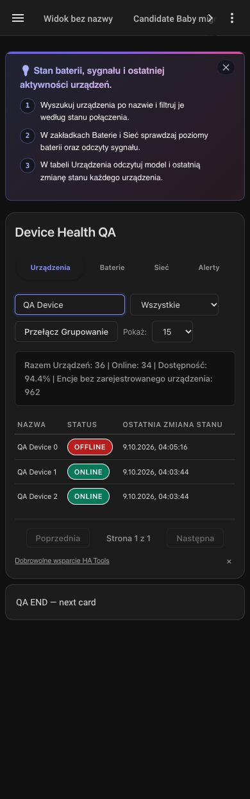 |
| Batteries | 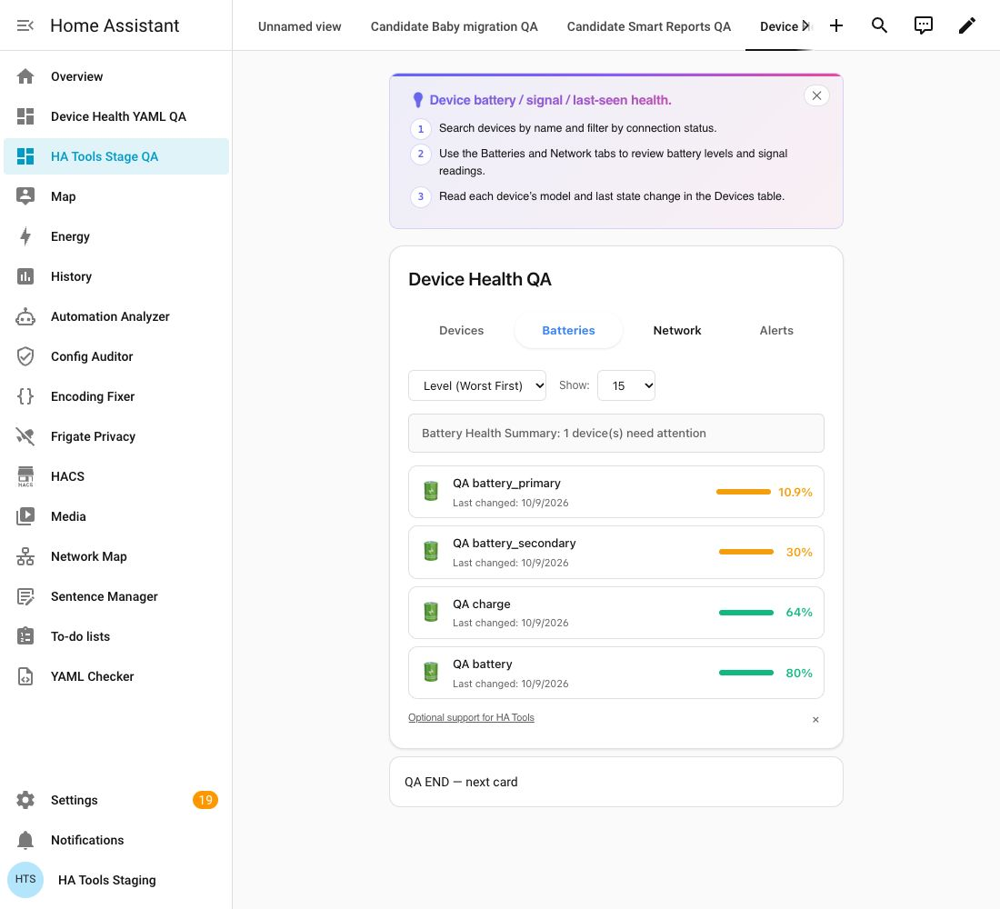 | 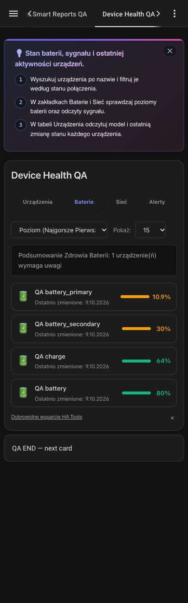 |
| Network | 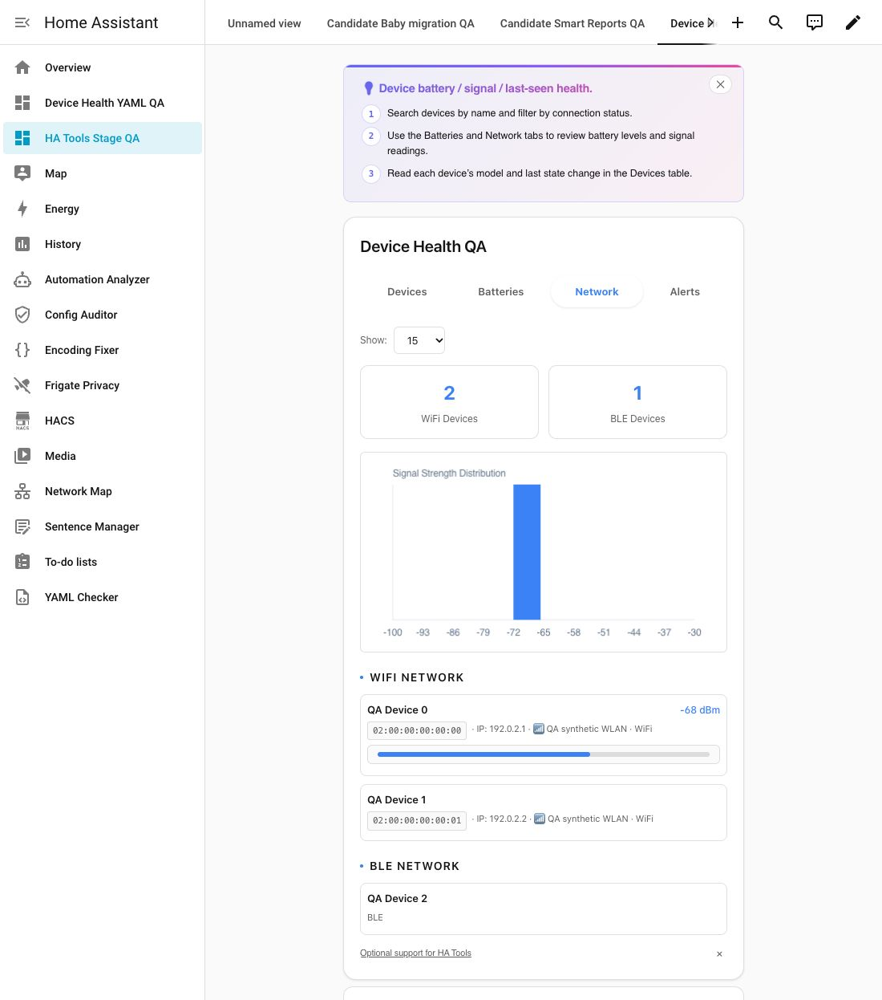 | 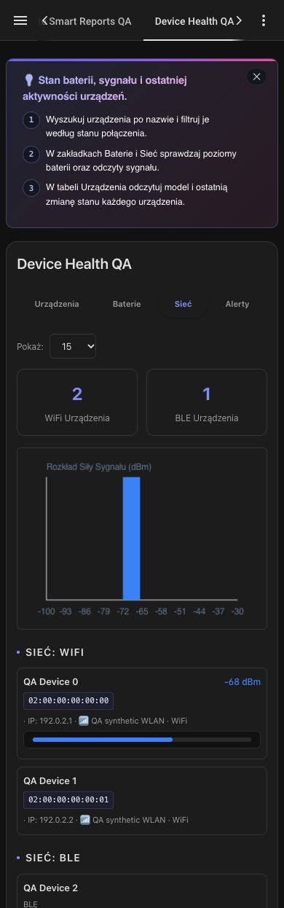 |
| Alerts | 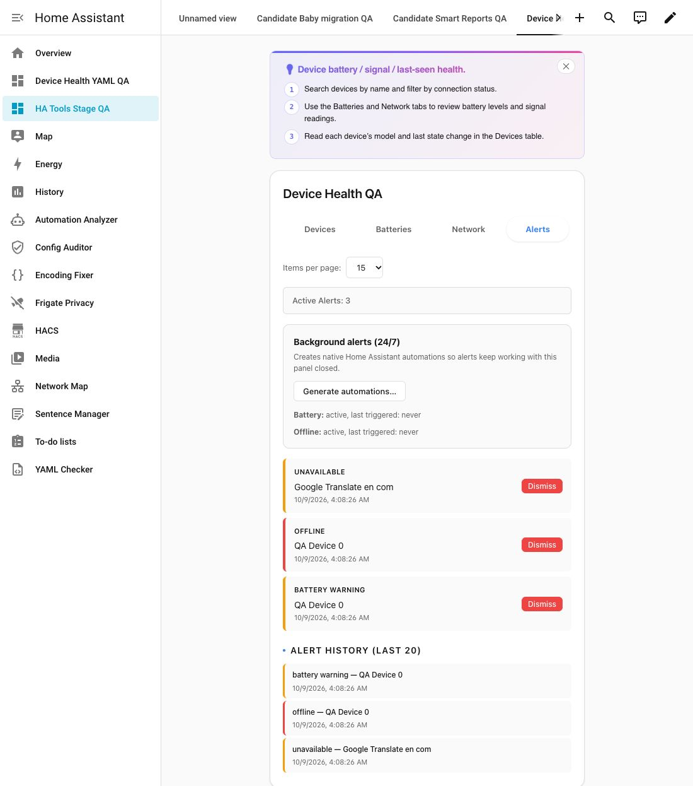 | 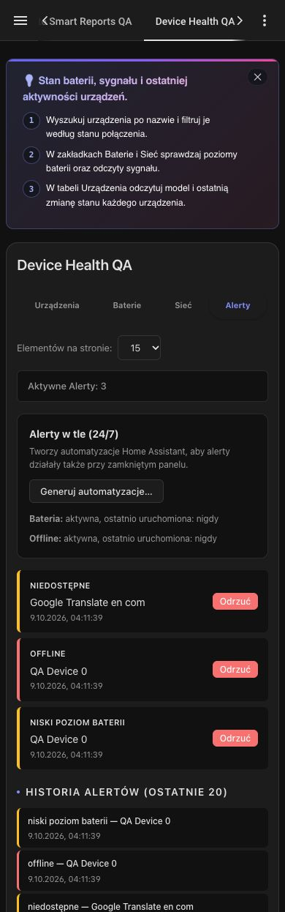 |

Additional native checks show [router disconnection with GPS and another connected device staying online](docs/screenshots/review-router-connectivity.png), and [a valid −95 dBm attribute reading when signal entities are damaged](docs/screenshots/review-rssi-fallback.png). Screenshot source commits and test scope are recorded in [the provenance](docs/screenshots/README.md).

Dark mode follows your Home Assistant theme. The signal chart uses available
RSSI readings. Invalid signal entities are skipped in favor of valid sibling
readings, then numeric `rssi` or `signal_strength` attributes. Missing readings
remain unknown and do not become a zero signal value.

## Installation / Instalacja

The public Dashboard 4.3.1 declares Home Assistant 2024.1 as its minimum. The
minimum for the future Integration release is **not yet established**: its source
compatibility and runtime still need verification. This candidate currently sets
`homeassistant: 2024.7.0` in `hacs.json`; that is a distribution gate, not proof
of compatibility. Integration installation applies **after** the announced
Dashboard transition period and availability in HACS; until then keep using the
Dashboard release.

**Planned transition:** After a transition period, the current Device Health
Dashboard listing will be removed from the catalog. Its successor will be an
Integration. For now, update the existing Dashboard card in HACS as usual; the
card and its settings remain. Do not remove the card or install an integration
for this transition now. Keep a backup of your dashboard configuration. The date
and confirmed migration instructions will be announced later, before the change.

**Planowana zmiana:** Po okresie przejściowym obecny wpis Device Health Dashboard
zostanie wycofany z katalogu. Jego następcą będzie Integration. Na razie aktualizuj
obecną kartę Dashboard w HACS jak zwykle; karta i jej ustawienia pozostają. Nie
usuwaj teraz karty ani nie instaluj integracji na potrzeby tej zmiany. Zachowaj
kopię konfiguracji pulpitu. Termin i potwierdzoną instrukcję migracji podamy
później, przed zmianą.

**Once the transition ends and Integration is available:**

1. Install **Device Health** from HACS **Integration**, restart Home Assistant,
   then add **Device Health** under Settings → Devices & services.
2. For a new installation, the integration registers its module in storage-mode
   dashboard resources. Refresh the browser and add `custom:ha-device-health`.
   If resources are managed in YAML, add the module shown below yourself and
   restart HA. Do not add a second Device Health module.

### Release transition / Okres przejścia wydania

The Integration release must be available before the HACS category change is
submitted. During catalog propagation, the Dashboard entry can still point to
that Integration release. This package retains the root `ha-device-health.js`
and the existing Dashboard resource path for compatibility; their presence
alone does not prove that HACS will install or update both categories correctly.
The candidate’s shared `hacs.json` minimum of 2024.7 can prevent the new
release from being offered or downloaded on HA 2024.1–2024.6 even while the
catalog still calls it Dashboard. The published 4.3.1 tag retains its own 2024.1
minimum; retaining or selecting that version and its existing resource must be
verified in HACS, not assumed. This compatibility tradeoff requires owner review
before release; do not change the published 4.3.1 metadata.

Before release, test the **exact stable release** in an isolated HA/HACS setup:
update an existing Dashboard installation while the catalog still says Dashboard,
verify its resource URL, card, configuration and rollback, then test a fresh and
migrated Integration installation after the category changes. Block the category
change and release progression if either path fails; resolve HACS packaging or
catalog behavior and repeat both tests before proceeding.

Wydanie Integration musi być dostępne przed zgłoszeniem zmiany kategorii HACS.
Podczas propagacji katalog może nadal wskazywać Dashboard, ale pobierać najnowsze
wydanie Integration. Pakiet zachowuje główny `ha-device-health.js` i dotychczasową
ścieżkę zasobu Dashboard; sama ich obecność nie dowodzi poprawnej instalacji i
aktualizacji w obu kategoriach. Wspólne minimum kandydata 2024.7 w `hacs.json`
może zablokować oferowanie lub
pobranie nowej wersji na HA 2024.1–2024.6 jeszcze pod kategorią Dashboard.
Opublikowany tag 4.3.1 zachowuje własne minimum 2024.1; zachowanie albo wybór tej
wersji i jej zasobu trzeba sprawdzić w HACS. Ten kompromis wymaga oceny ownera
przed wydaniem; nie zmieniaj metadanych opublikowanego 4.3.1.

Przed wydaniem sprawdź **dokładne wydanie stabilne**
w odizolowanym HA/HACS: aktualizację istniejącego Dashboard przy starej kategorii,
jego URL zasobu, działanie i konfigurację karty oraz powrót; następnie świeżą
instalację i migrację Integration po zmianie kategorii. W razie błędu zablokuj
zmianę kategorii i dalsze wydanie, wyjaśnij obsługę pakietu lub katalogu HACS i
powtórz oba testy.

### Moving from Dashboard to Integration

1. Back up Home Assistant and your dashboard configuration. Install and set up
   the Integration as above. An existing Dashboard resource stays untouched, so
   the old card may still be displayed until the next steps are complete.
2. Open Settings → System → Repairs and select **Migrate the Device Health
   dashboard resource**. Remove the old Device Health **Dashboard** installation
   in HACS, then check Settings → Dashboards → Resources. If the old Device
   Health resource remains, remove that resource only. Leave all other resources
   and existing dashboard cards alone. The card may temporarily stop rendering.
3. Submit the repair. It checks that old copies are gone and registers the
   Integration module. If the check fails, remove the indicated old resource and
   submit again. Refresh the browser and check the existing card and its settings.
   Do not add the new module before removing the old one: loading both defines
   the same custom element twice.

If Repairs is unavailable, use the Resources screen to remove the old resource
and add exactly this URL as a **JavaScript module**, then refresh the browser:
`/ha_device_health/ha-device-health.js?v=5.3.0`. For YAML-managed resources,
replace the old Device Health entry in `lovelace.resources` with that URL and
`type: module`, restart HA and refresh the browser. Preserve all other entries.
If a manual or unknown Device Health module remains, the integration will not
replace it; decide which one you own and remove it yourself before retrying.

For rollback, remove the Integration and its Device Health resource (including
any manually added URL), restore the previous Dashboard release in HACS and its
resource, and refresh. Restore the dashboard from backup only if needed; the
migration itself does not edit dashboard configurations. Confirm the old card
renders before considering rollback complete.

### Migracja z Dashboard do Integration (PL)

Publiczne wydanie Dashboard 4.3.1 deklaruje minimum Home Assistant 2024.1.
Minimum przyszłej integracji **nie jest jeszcze ustalone**: wymaga sprawdzenia
zgodności kodu i działania. Kandydat ma obecnie `homeassistant: 2024.7.0` w
`hacs.json`; to ograniczenie dystrybucji, nie dowód zgodności. Poniższe kroki
wykonaj **po** okresie przejściowym i udostępnieniu Integration w HACS; do tego
czasu korzystaj z wydania Dashboard.

1. Zrób kopię HA i konfiguracji dashboardów. Zainstaluj **Device Health** jako
   **Integration** w HACS, uruchom ponownie HA i dodaj integrację w Ustawienia →
   Urządzenia i usługi. Stary zasób Dashboard pozostanie bez zmian.
2. Otwórz Ustawienia → System → Naprawy i wybierz **Przenieś zasób karty Device
   Health**. Usuń starą instalację Device Health **Dashboard** w HACS. W
   Ustawienia → Dashboardy → Zasoby sprawdź, czy stary zasób zniknął; jeśli nie,
   usuń tylko jego wpis. Nie usuwaj istniejących kart ani innych zasobów. Karta
   może chwilowo przestać się wyświetlać.
3. Zatwierdź naprawę. Sprawdzi, czy nie pozostała stara kopia, i zarejestruje
   moduł integracji. Jeśli sprawdzenie się nie powiedzie, usuń stary zasób i
   ponów naprawę. Odśwież przeglądarkę i sprawdź kartę oraz jej ustawienia. Nie
   dodawaj nowego modułu przed usunięciem starego: oba definiują tę samą kartę.

Bez Napraw usuń stary wpis i dodaj w Zasobach jako **moduł JavaScript** dokładnie
`/ha_device_health/ha-device-health.js?v=5.3.0`, po czym odśwież przeglądarkę.
Dla zasobów YAML zastąp stary wpis Device Health w `lovelace.resources` tym
adresem i `type: module`, uruchom HA ponownie i odśwież przeglądarkę. Pozostałe
wpisy zachowaj. Integracja nie przejmuje nieznanej lub ręcznej kopii: usuń ją
samodzielnie przed ponowieniem, jeśli należy do Ciebie.

Aby wrócić do poprzedniej wersji, usuń integrację i jej zasób Device Health
(także dodany ręcznie), przywróć poprzednie wydanie Dashboard w HACS oraz jego
zasób i odśwież przeglądarkę. Migracja nie edytuje konfiguracji dashboardów;
kopię przywracaj tylko w razie potrzeby. Sprawdź, czy stara karta działa.

## Quick start

```yaml
type: custom:ha-device-health
```

That's it — no options are required.

The default heading and visual editor follow your Home Assistant language
(English or Polish). Set `title` to keep your own heading in either language;
leave it unset to use the translated default. Changing language preserves your
editor draft, thresholds and text selection.
Device status and network group captions use the same language; device names,
authored models and connection classifications are retained.

## Recorded device history

On **Devices**, choose a device and a **7-day or 30-day** range, then select
**Load / refresh**. The card reads state updates retained by Home Assistant
Recorder. Reopening the card or restarting HA does not erase Recorder records;
what remains available depends on your Recorder retention and exclusions.

Switch between **Chart** and **Data** to inspect the same records. Select a point
or use Previous/Next to see its source, value, unit and exact timestamp. Percent
battery levels and voltage have separate charts; zero remains a measurement.
Reported unavailable/unknown states and measured connection changes appear as
separate events. Availability, measured disconnection and low battery readings
are grouped into observed episodes. Battery episodes use the current warning
threshold shown beside them (percent only), and update when that setting changes.
Recovery or unknown endings are stated explicitly. This is not a measurement of continuous uptime.

The source panel shows the requested range, display time zone, first/last actual
record, missing sources and limits. Quiet intervals do not prove missing data or
an offline device. The card does not backfill, interpolate or alter Recorder.
Reads are explicit and bounded to 16 visible entity sources, 12,000 input records
and 2,400 projected rows; partial results and omitted sources remain visible.

History requires History/Recorder. Administrators can read it on HA versions
supported by the installed release; household history access requires HA 2026.5.0
or newer and
follows HA permissions. Changing device, account, instance or connection clears
incompatible results. A failed read does not retry automatically.

## Background notifications

The Alerts tab works while the card is open. An administrator can choose
**Generate automations…**, review the YAML and choose **Create** to keep native
Home Assistant notifications running with the card closed. Opening or cancelling
the preview does not save anything. Household users can view health information
and dismiss local card alerts; they cannot create or reload automations.

Create saves or updates `ha_device_health_battery_alert` and
`ha_device_health_offline_alert`, then reloads Home Assistant automations.
The standard UI automation configuration must be available, usually through
`automation: !include automations.yaml`. Both automation states and partial save
or reload errors are shown in the card; review an error before retrying.

The battery automation triggers when a reading crosses **below** the warning
threshold. The offline automation watches the generated entity list for
`unavailable` for the configured duration. These are per-entity notifications;
the card's physical device alerts also understand connectivity sensors and
router/connection trackers. Existing
low readings do not by themselves trigger a newly created numeric-state automation.

The generator uses one shared pair of automation IDs for the HA instance.
Creating from another card updates that pair with its thresholds and entity list.
Re-run it after adding devices. The battery list is limited to the first 150
readings, with a warning when it is truncated. Review the preview before saving.

## FAQ

**Do I have to configure anything?**
No. The card discovers batteries and devices from your existing entities.

**Why is a device marked unknown?**
The device is registered in HA but has no current entity state to measure.
The card will not invent a health result or Wi-Fi classification.

**Why doesn't my battery show up?**
It needs a `%` unit and `device_class: battery`, or a battery name with no
conflicting device class, plus a finite numeric 0–100 state. Text states ("low"/"ok") and quantity helpers without this
metadata are excluded.

**Does this send data anywhere?**
The card does not upload your states or registries. It uses your existing Home
Assistant connection and has no telemetry or CDN dependencies. Optional support
links open an external website only when you choose them.

## Changelog

See [CHANGELOG.md](CHANGELOG.md).

## Support

- [Buy Me a Coffee](https://buymeacoffee.com/macsiem)
- [PayPal](https://www.paypal.com/donate/?hosted_button_id=Y967H4PLRBN8W)

The optional in-card support link is shown only to administrators. Dismiss it in the card or set `show_support: false` in the card configuration.

## License

MIT, see [LICENSE](LICENSE).

## Privacy and data

The card reads Home Assistant states and device/entity registry metadata to show
health information. Live alert history, acknowledgements, loaded history results
and registry data remain in card memory. Recorded source history stays in Home
Assistant Recorder under its own retention settings. The selected tab and instruction/support dismissal are remembered
in this browser for the plugin; those preferences are shared across its cards
and accounts on the same HA origin. Browser storage contains no device names,
addresses or alert history from this implementation.

Only an explicit administrator Create action saves the two native automations
and reloads them. Their configuration contains entity IDs and thresholds in your
Home Assistant instance; notifications can include entity names. Device and
entity labels can identify your home. Remove labels, identifiers and addresses
from screenshots or bug reports.

See [SECURITY.md](SECURITY.md) for safe vulnerability reporting and [NOTICE](NOTICE) for licensing notices.

## Independent project

Device Health is an independent community project and is not affiliated with or
endorsed by Home Assistant or HACS. Their names identify compatibility.
